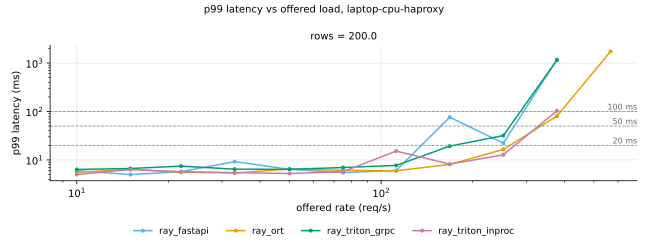
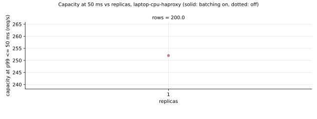
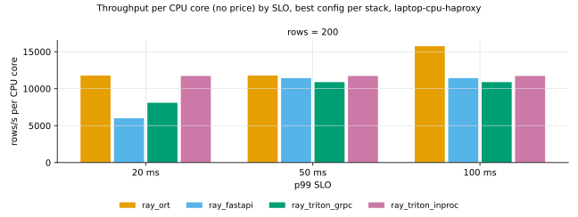

# Serving benchmark: FastAPI vs Ray Serve vs Triton

We compared five ways to serve the same DeepFM ONNX model: FastAPI + ORT, Ray Serve + ORT, Ray Serve + Triton (gRPC and in-process), and Triton alone.
Method: open-loop k6 load, same ONNX file, same ORT settings, capacity is the highest rate with p99 under the SLO (20, 50 or 100 ms) and no errors.
Date: 2026-11-15. Environment: laptop-cpu, laptop-cpu-haproxy, laptop-cpu-tuned.

## Summary (SLO p99 <= 50 ms, best config per stack)

**laptop-cpu, rows = 200**

| Stack | Best config (batching, replicas) | Capacity req/s | p99 ms at capacity | CPU util % | Peak RSS MB | Cold start s | $/1M req |
|---|---|---|---|---|---|---|---|
| fastapi_ort | batch off, 1x | 168* | 17* | 91 | 86 | 2 | n/a |
| triton | batch on, 1x | 252* | 28* | 91 | 47 | 1 | n/a |

**laptop-cpu-haproxy, rows = 200**

| Stack | Best config (batching, replicas) | Capacity req/s | p99 ms at capacity | CPU util % | Peak RSS MB | Cold start s | $/1M req |
|---|---|---|---|---|---|---|---|
| ray_ort | batch off, 1x | 252* | 16* | 71 | 1019 | 12 | n/a |
| ray_fastapi | batch off, 1x | 252* | 22* | 73 | 1022 | 10 | n/a |
| ray_triton_grpc | batch off, 1x | 252* | 32* | 77 | 1028 | 9 | n/a |
| ray_triton_inproc | batch off, 1x | 252* | 13* | 72 | 1068 | 13 | n/a |

**laptop-cpu-tuned, rows = 200**

| Stack | Best config (batching, replicas) | Capacity req/s | p99 ms at capacity | CPU util % | Peak RSS MB | Cold start s | $/1M req |
|---|---|---|---|---|---|---|---|
| ray_ort | batch off, 1x | 75* | 17* | 72 | 936 | 10 | n/a |
| ray_triton_grpc | batch off, 1x | 75* | 22* | 74 | 945 | 10 | n/a |
| ray_triton_inproc | batch off, 1x | 112* | 45* | 81 | 984 | 15 | n/a |

`*` = number comes from search steps only (not confirmed with full reps).

## Charts

## Overload

No overload data.

## Recommendation

- Highest capacity at 50 ms: ray_fastapi at rows=200 (252 req/s).
- Lowest $/1M requests: n/a (no price).
- Smallest peak RSS: ray_ort at rows=200 (1019 MB).
- Fastest cold start: ray_triton_grpc at rows=200 (9 s).
- Pick ray_fastapi for rows=200 traffic and ray_fastapi for rows=200; pick the cheapest or smallest stack above when the SLO is met by several.

Details: bench/report/APPENDIX.md
